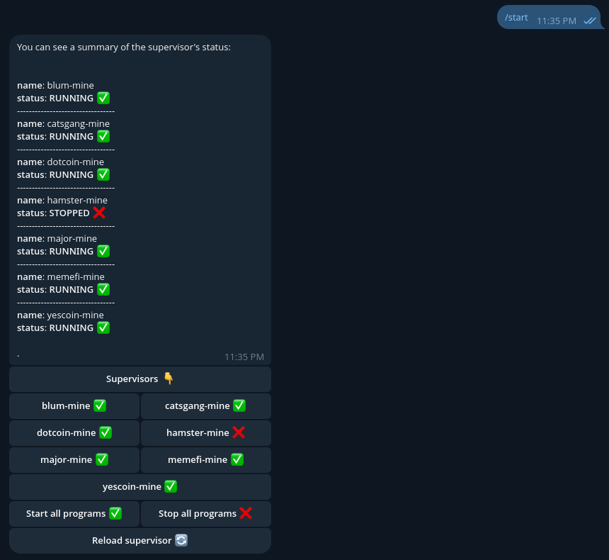
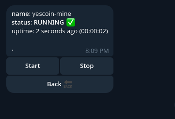

# Supervisor Manager Telegram Bot

A Telegram bot for managing [supervisor](http://supervisord.org/) programs remotely. Control, monitor, and manage your supervised processes directly from Telegram — no need to SSH into your server just to restart a crashed service.

> **Note:** This project was originally written in 2024 for personal use. It was **substantially refactored in 2026**, with a full rewrite of error handling, a cleaner architecture.

---

## ✨ Features

- 📋 **List programs** — View all programs managed by supervisor with their current status
- ▶️ **Start / Stop / Restart** — Control individual programs directly from Telegram
- 📊 **Status monitoring** — Check the state of any program (`RUNNING`, `STOPPED`, `FATAL`, etc.)
- 🔐 **Access control** — Restrict bot usage to a specific Telegram chat ID
- 🛡️ **Logs** — All errors are logged, allowing you to identify the issue via the logs should an unexpected event occur

---

## 📦 Installation

### Option 1: Download a prebuilt binary (recommended)

Head over to the [Releases](../../releases) page and download the binary for your platform. CI automatically builds and publishes releases for supported targets.

### Option 2: Build from source

Make sure you have the Rust toolchain installed ([rustup](https://rustup.rs/)).

```bash
git clone https://github.com/amirhossein-fzl/supervisor-manager-tgbot.git
cd supervisor-manager-tgbot
cargo build --release
```

The compiled binary will be at `target/release/supervisor_manager_tgbot`.

---

## ⚙️ Configuration

Copy the example environment file and fill in your values:

```bash
cp .env.example .env
```

Then edit `.env`:

| Variable              | Description                                                         | Example                      |
| --------------------- | ------------------------------------------------------------------- | ---------------------------- |
| `BOT_TOKEN`           | Your Telegram bot token (from [@BotFather](https://t.me/BotFather)) | `123456:ABC-DEF...`          |
| `ADMIN_ID`            | Telegram chat ID allowed to use the bot                             | `123456789`                  |
| `SUPERVISOR_URL`      | Supervisor XML-RPC endpoint                                         | `http://127.0.0.1:9001` |
| `TELOXIDE_PROXY`      | Proxy in telegram server communication (Support http/socks5)        | `socks5://127.0.0.1:8443`    |

> ⚠️ Make sure the `.env` file lives in the same directory as the binary when running.

Make sure supervisor's `[inet_http_server]` section is enabled and configured:

```ini
[inet_http_server]
port = 127.0.0.1:9001
```

---

## 🚀 Usage

Run the bot:

```bash
./supervisor_manager_tgbot
```

Then open Telegram, find your bot, and send `/start` to manage supervisor.




---

## 🤝 Contributing

Contributions, issues, and feature requests are welcome. Feel free to open an [issue](../../issues) or submit a pull request.

---

## 📄 License

This project is licensed under the terms found in the [LICENSE](LICENSE) file.

---

## ☕ Support

If this project was useful to you, you can support development via crypto:

- **Ethereum / USDC (ERC20):** `0xf6CD13ca152CdaAa59510E9E2e0F42a0385c987e`
- **Solana / USDC (SOL):** `BbAg5uWr3qcM6Lj3m17PbKiH4wuXkUW2F5yeakS1WaBW`
- **BNB / USDC (BSC):** `0xf6CD13ca152CdaAa59510E9E2e0F42a0385c987e`
- **Base / USDC (Base):** `0xf6CD13ca152CdaAa59510E9E2e0F42a0385c987e`

